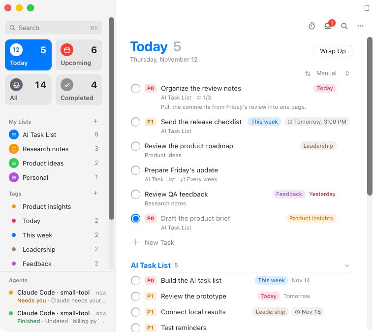

# Shishi

Shishi is a task list for people who work alongside AI. A narrow Today list stays beside your editor. Expand it for the full workspace, with smart lists, your own lists and tags in the sidebar. Claude Code, Codex and other agents report to a small Agents list while they work, and their finished replies wait in a quiet inbox, so a result never interrupts you while you type. The interface follows macOS: system fonts and accent color, a translucent sidebar, light and dark appearance, and a menu bar item.

[Download the English macOS preview](https://github.com/shen25308/small-tool/releases/tag/v1.6.0) · [Data and permissions](Release/data-and-permissions.md)



[Floating Today list](Previews/today.png) · [Dark appearance](Previews/workspace-dark.png) · [Inbox](Previews/inbox.png) · [Small result panel](Previews/result-panel.png)

## Run on a Mac

Version 1.7 requires an Apple Silicon Mac running macOS 26 or later. Download the ZIP from the release, extract it, and open **Shishi.app**. The preview uses local ad-hoc signing and has not been notarized by Apple. The ZIP includes the offline model, inference engine, Python runtime, and third-party notices.

If you are upgrading, Shishi keeps the same local workspace, inbox, and connection preferences. If an MCP client or Grok task was configured with the previous app’s absolute path, copy its configuration again after opening Shishi.app.

The design reference for the Today board is [Youniverse’s work task list demo](https://v.douyin.com/qhlq-TKt314/). The previews above are captured from the running Mac app by the build workflow, with sample tasks.

## Plan your day

Use the toolbar to switch between the floating Today list and the full workspace, or pin the small list above other windows. The sidebar has four smart lists (**Today**, **Upcoming**, **All**, **Completed**), your own lists and your tags. Press ⌘1 to ⌘4 to jump between the smart lists.

- **Add a task by typing.** Choose **New Task** (⌘N) and write naturally: `Send report friday 3pm #Finance !p1 @Work every week`. Shishi recognizes dates (today, tomorrow, friday, next week, in 3 days, Dec 3, 11/20), times, `!p0`–`!p2` priority, `#tag`, `@list` and repeats, and shows what it understood before you press Return. A date schedules the task. A time or the words *by* and *due* set its deadline.
- **Work through the list.** The round checkbox completes a task. Click a priority, tag or deadline to change it in place. Right-click a task to schedule it, set its priority, move it, duplicate it or delete it (with Undo). Drag a task onto Today, a list or a day in Upcoming.
- **Details and deadlines.** Open a task for notes, subtasks, a deadline with time, and a repeat rule. Completing a repeating task schedules the next one. A due, unfinished task creates one quiet inbox reminder when Shishi is running or reopens. Scheduling a task for Today and setting its deadline are independent.
- **Upcoming** groups the next seven days, with an Overdue section. **Completed** groups finished tasks by day and can be cleared.
- **Search and commands (⌘K).** One field finds tasks, lists and tags, jumps to a view, runs commands, or adds the text as a new task.
- **Focus timer.** Start 15, 25 or 50 minutes on the next task. Completed minutes count toward your wrap-up.
- **Wrap Up** shows what you finished, what is still open, your streak and a seven-day chart. It can move open tasks to tomorrow and copy a summary. **Copy Tasks as Markdown** in the ••• menu exports every list.

## Read a result beside your editor

Choose **More (•••) → Show result panel** and drag the panel beside your document. The result panel and inbox start with collapsed previews. **More → Latest result** opens the latest receipt inside the workspace. Click the preview or focus it and press Space to expand it. Shishi selects sentences from the saved reply, including changes, checks, unresolved work, and file names. Use the original-reply control to read the stored text.

If a new result arrives while you are reading, a control offers to show the latest result. You can finish reading first. Use the back control to return to the summary, the workspace, or your editor. Escape goes up one level in settings. Some replies saved by earlier versions of Shishi contain only the first 4,000 characters. The interface follows the Mac's light or dark appearance. Personal tasks, project names, emails, and AI replies keep their original language.

## Connect a source

Open the inbox and choose **Connections…**, or press ⌘K and search for *Connections*.

- **Claude Code.** Choose **Connect**. Shishi adds hooks to your personal `~/.claude/settings.json` (or `$CLAUDE_CONFIG_DIR`). It keeps every other setting, saves a copy as `settings.json.before-shishi`, and **Disconnect** removes only its own entries. While a session works, the **Agents** list shows *Working*. If Claude asks for permission, it shows *Needs you*. When the turn ends, the final reply goes to the inbox. The hooks run in the background, never delay Claude and never ask it to continue. Subagent activity is ignored. Run `python3 ClaudeCode/install.py status` to check a connection from the terminal.
- **Codex.** Enable the local Codex connection to read completion events and the final reply from saved sessions on this Mac. Unread finished turns also appear in Agents. If Shishi is closed when a turn ends, it can catch up after reopening while Codex retains the corresponding records. Disconnect to stop future reads. Existing receipts remain available.
- **Any other tool.** `Connectors/shishi_agents.py set --source "My tool" --session run-42 --state working --title "Nightly build"` puts a row in Agents, and `shishi-send.py` leaves a result in the inbox. Both are local, write one small file, and use no network.
- **Notion.** See below.
- **Gmail and Outlook.** Authorize a desktop OAuth client with the provider and choose one sender or all new mail. Cards show the subject, sender, and arrival time and can open the original message. Mail goes quietly into the inbox by default. Enable the floating-window option to see new mail beside your editor. Sync starts at first connection. Tokens are stored in macOS Keychain. Disconnecting offers to remove that account's local mail cards. This preview needs a registered Google desktop OAuth client or Microsoft Entra client ID. You can revoke access in your provider account.
- **GitHub Actions.** Enter a public repository as `owner/repo` and optionally specify a workflow. Completed runs show the conclusion, branch, and run number. The connector polls the public REST API about every five minutes and respects rate limits.
- **Grok Bot.** Copy the setup instructions from Connections and include them in a task. Grok manages permission to run its local delivery command. The terminal client has a separate [Grok Build stop hook](GrokBuild/README.md).
- **Other MCP clients.** Copy the local stdio configuration from Connections and ask the client to call `deliver_result` on completion with a stable event ID. The optional HTTP transport uses a loopback address and a bearer token. A cloud client requires a reachable HTTPS endpoint. [Grok custom connectors](https://docs.x.ai/grok/connectors/custom-mcp-tunneling)

### Stay out of the way

Agent progress shows in three quiet places: the **Agents** list in the sidebar, three rows at the bottom of the floating Today list, and the **menu bar item**, which counts working agents and unread results and lists each one. With the menu bar item on, Shishi keeps collecting results after you close its window. Turn it off in Connections to quit with the last window. The same section sets the appearance to follow the system, or to stay light or dark. Nothing here sends a system notification. Open a finished result from Agents to read it, or add a follow-up task from the result.

### Notion

Open **Connections → Notion**, paste the link to a task database and choose the list to sync. Create an internal integration in Notion, add it to the database with **••• → Connections**, and paste its secret when Shishi asks. The secret is stored in your Keychain and never reaches the page. Title, completion, deadline, priority and tag stay in step in both directions: pages in the database appear in the list, tasks you add to that list are created in Notion, and the Notion page wins if both sides changed. Shishi syncs when it starts, every 15 minutes and on **Sync Now**. It never deletes Notion pages.

## Turn messages into tasks

Choose **More (…) → Capture tasks from a message**, then paste a chat or meeting note. The bundled Qwen model extracts candidate tasks locally. Compare each suggestion with its source, edit its title, tag, or project, and choose which tasks to add. Drag a task into **Today** or use its Today action. The floating Today list can stay above other windows.

## Build from source

Install the macOS Swift command-line tools and Python 3. Extract the release ZIP first. From this repository, run the following command with the path to that extracted app. The build copies its pinned model, native inference engine, Python runtime, and licenses, then compiles the app from the Swift and UI sources here.

```sh
python3 build.py --assets /path/to/Shishi.app --output build/Shishi.app
```

Run the tests with `python3 -m unittest discover -s Tests` and `node --test Tests/*.test.mjs`. `node Tests/ui/check.mjs [folder]` drives the interface in Chromium against a stand-in for the Mac app (it needs Playwright) and saves screenshots. GitHub Actions builds the app on macOS, launches it with sample data and publishes screenshots of the real window.

If you keep the extracted app next to the source folder, `python3 build.py` uses it by default. To inspect a build, run `python3 Release/verify-release.py build/Shishi.app`. The report distinguishes bundle integrity from Developer ID distribution readiness. A publisher can provide mail OAuth client registrations in `Contents/Resources/Mail/provider-config.json` before signing.

[Distribution and notarization guide](Release/distribution.md) · [Historical 1.3.1 release check](Release/checks-1.3.1.json)
